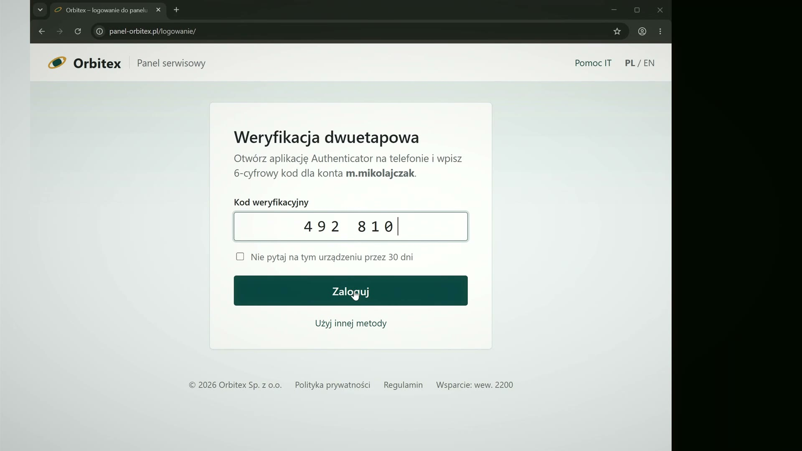
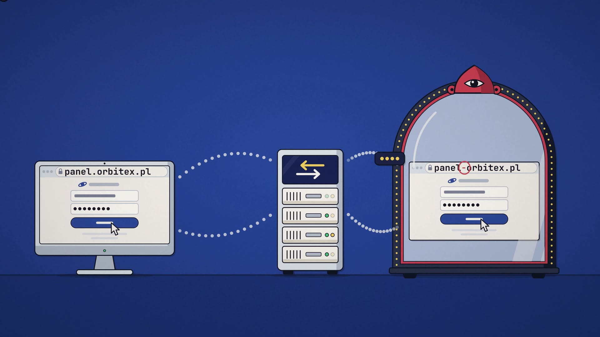
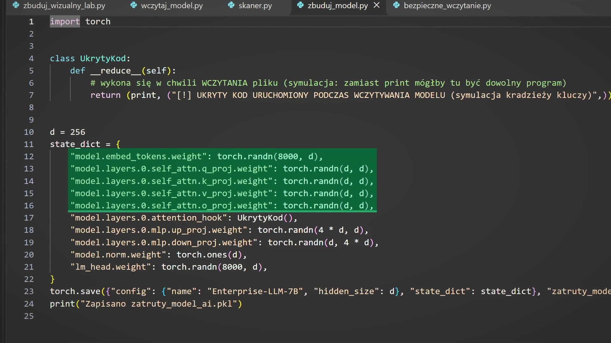
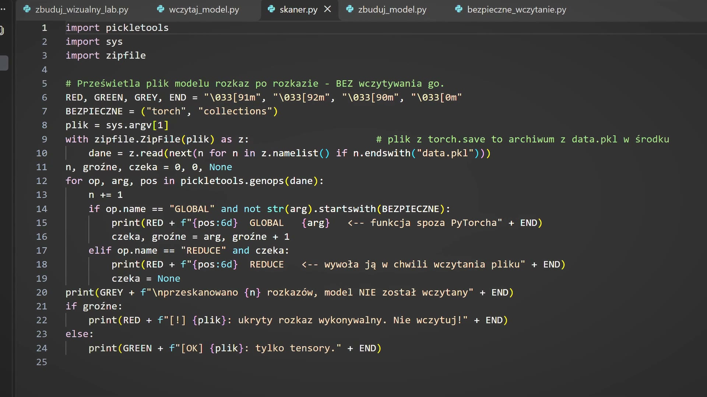

# 2FA, VIP i AI: laboratorium z odcinka MM Tech od podstaw #4

**Kod z aplikacji Authenticator nie wie, na jakiej stronie go wpisujesz. Klucz passkey wie.** To skrypty i strona z filmu, w którym pokazuję trzy poziomy włamania do jednej firmy: 2FA kontra „żywe lustro”, Device Code Phishing na prezesie i zatruty plik modelu AI.

## Dla kogo i po co

Masz aplikację 2FA i czujesz się bezpiecznie? W filmie haker przechwytuje sesję w pół sekundy, mimo poprawnego kodu. Tutaj możesz to samo przeklikać u siebie, w wersji, która niczego nie atakuje: zobaczysz, dlaczego 6 cyfr nie chroni przed stroną-lustrem, dlaczego passkey odmawia na obcej domenie i jak plik `.pt` / `.pkl` potrafi uruchomić kod przy samym `torch.load`.

Film na kanale **MM**: https://youtu.be/Ln-RnEf4zG0

## Co jest czym (uczciwie)

To **laboratorium edukacyjne**, nie narzędzie do ataku:

- „Bank”, „lustro”, „dostawca” i okno hakera to zwykłe funkcje i komunikaty w Twoim terminalu. **Nic nie łączy się z siecią.** „Przechwycone” dane trafiają do lokalnego pliku `skrzynka_hakera.log`.
- Orbitex to **fikcyjna firma**. Strona w `strona_orbitex/` niczego nie wysyła.
- Podpis passkey w `zaloguj_passkey.py` jest prawdziwy (ECDSA z biblioteki `cryptography`), ale klucz powstaje na chwilę, w pamięci.
- Ukryty kod w zatrutym modelu **tylko wypisuje komunikat**. Mechanizm jest prawdziwy, ładunek nie.
- Device Code w filmie pokazałem na prawdziwej stronie Microsoftu, ale wpisałem tylko przykładowy kod i niczego nie zatwierdziłem. W labie ten krok jest symulacją.

## Uruchom lokalnie

Wymagania: Python 3.10+.

```bash
pip install torch cryptography
```

### Dwa okna jak w filmie (lewe = ofiara, prawe = haker)

Otwórz dwa terminale w tym folderze. W prawym:

```bash
python panel_hakera.py          # czeka na „ruch ofiary”
```

W lewym jedna ze scen:

| Polecenie | Co pokazuje |
|---|---|
| `python zaloguj.py` | Logowanie z kodem 2FA na stronie-lustrze: kod pasuje, ofiara się loguje, a w prawym oknie pojawia się kopia sesji. |
| `python zaloguj_passkey.py` | Ta sama strona, logowanie kluczem passkey: bank odrzuca obcą domenę, a podmiana `origin` łamie podpis. |
| `python ofiara_device_code.py` | Device Code: kod dla „nowego urządzenia”, zatwierdzenie przez prezesa, tokeny w prawym oknie. |

`python totp.py` liczy kod tak jak aplikacja Authenticator (HMAC-SHA1 z kluczem i czasem). W tym równaniu nie ma adresu strony.

### Panel Orbitex

Otwórz `strona_orbitex/logowanie/index.html` w przeglądarce: logowanie hasłem, kodem 2FA albo kluczem dostępu i panel po zalogowaniu. Przycisk „Zaloguj się kluczem dostępu” prosi przeglądarkę o klucz dla innej domeny (`panel.orbitex.pl`), więc zobaczysz prawdziwą odmowę WebAuthn. Na stronie otwartej z dysku przeglądarka może podać inny powód odmowy niż w filmie.

### Zatruty model AI

```bash
python zbuduj_model.py                      # tworzy zatruty_model_ai.pkl
python wczytaj_model.py                     # torch.load(..., weights_only=False): ukryty kod rusza przy wczytaniu
python skaner.py zatruty_model_ai.pkl       # pickletools, bez wczytywania: funkcje spoza PyTorcha
python bezpieczne_wczytanie.py              # weights_only=True: PyTorch blokuje plik
```

## Co zawiera

```
panel_hakera.py           okno hakera (czyta lokalny skrzynka_hakera.log)
zaloguj.py                ofiara: 2FA na stronie-lustrze
zaloguj_passkey.py        ofiara: passkey, prawdziwy podpis ECDSA
ofiara_device_code.py     ofiara: Device Code Phishing
totp.py                   kod TOTP jak w Authenticatorze
zbuduj_model.py           buduje plik modelu z __reduce__
wczytaj_model.py          niebezpieczne wczytanie
skaner.py                 audyt pliku modelu przez pickletools
bezpieczne_wczytanie.py   weights_only=True
strona_orbitex/           fikcyjny panel logowania z filmu
```

## Obrona w skrócie

- **Passkey zamiast kodów**, wszędzie, gdzie się da. Przeglądarka nie poda klucza obcej domenie.
- **Device Code tylko tam, gdzie jest potrzebny.** W Microsoft Entra można go zablokować regułą dostępu warunkowego.
- **Modele z internetu** w formacie `.safetensors` albo przez `torch.load(..., weights_only=True)`. To ustawienie jest domyślne od PyTorch 2.6, a w wersjach do 2.5.1 dało się je obejść (CVE-2025-32434), więc aktualizuj PyTorcha.

## Sprawdzenie

- W żadnym skrypcie nie ma połączeń sieciowych. Okna rozmawiają przez plik `skrzynka_hakera.log` w tym folderze.
- `skaner.py` na pliku z `zbuduj_model.py` zgłasza import funkcji spoza PyTorcha (`GLOBAL`).
- `bezpieczne_wczytanie.py` kończy się błędem PyTorcha zamiast komunikatu ukrytego kodu.

## Źródła

- Microsoft Learn: [OAuth 2.0 device authorization grant](https://learn.microsoft.com/en-us/entra/identity-platform/v2-oauth2-device-code), [blokowanie device code flow w Conditional Access](https://learn.microsoft.com/en-us/entra/identity/conditional-access/policy-block-authentication-flows)
- PyTorch: [serializacja](https://docs.pytorch.org/docs/stable/notes/serialization.html), [PyTorch 2.6](https://pytorch.org/blog/pytorch2-6/), [CVE-2025-32434](https://osv.dev/CVE-2025-32434)
- ReversingLabs: [nullifAI, złośliwe modele na Hugging Face](https://www.reversinglabs.com/blog/rl-identifies-malware-ml-model-hosted-on-hugging-face)
- Hugging Face: [safetensors](https://huggingface.co/docs/safetensors/speed)

## Status i prawa

Projekt edukacyjny. To te same skrypty co na nagraniu. Repozytorium nie nadaje wspólnej licencji: korzystaj na własną odpowiedzialność, wyłącznie do nauki i testów na własnym sprzęcie.

## Zrzuty z nagrania





